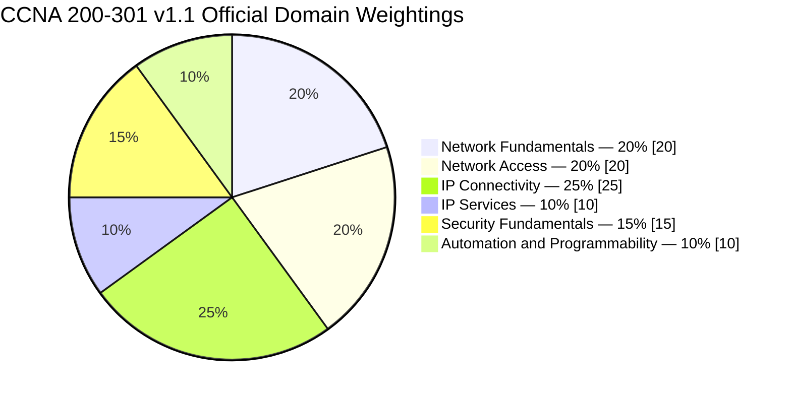
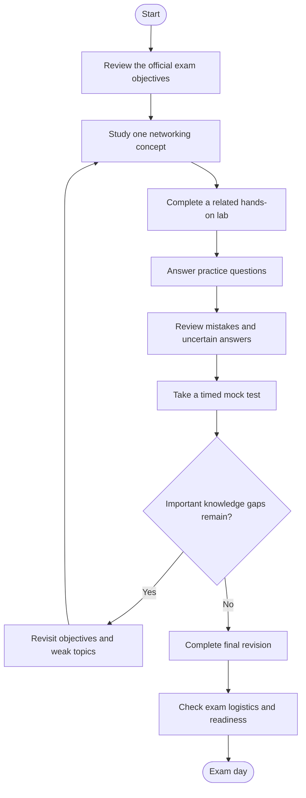
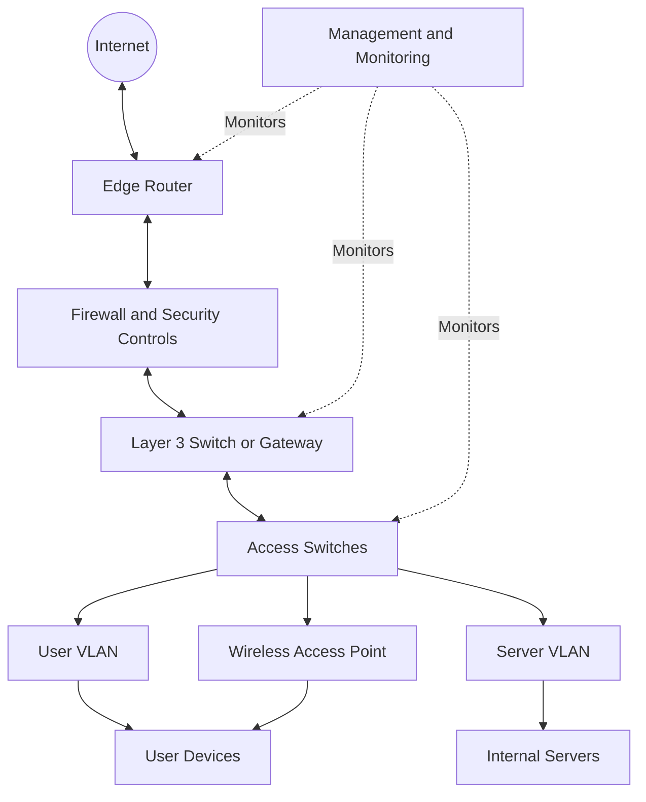
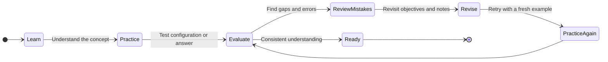
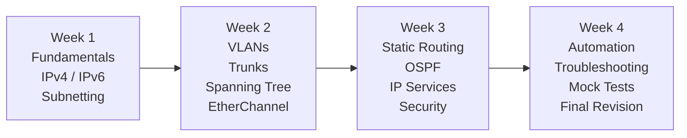

# Cisco 200-301 CCNA Study Guide and Exam Preparation

A practical, hands-on study guide for the Cisco Certified Network Associate (CCNA) certification. Learn networking fundamentals, switching, IP routing, network services, security, and automation through structured explanations, lab ideas, practice questions, and visual diagrams.

---

## Table of Contents

- [Overview](#overview)
- [About the CCNA Certification](#about-the-ccna-certification)
- [Who Should Prepare?](#who-should-prepare)
- [Current Exam Objectives and Weightings](#current-exam-objectives-and-weightings)
- [CCNA Preparation Flowchart](#ccna-preparation-flowchart)
- [Networking Architecture Diagram](#networking-architecture-diagram)
- [Study and Revision Cycle](#study-and-revision-cycle)
- [Step-by-Step Preparation Guide](#step-by-step-preparation-guide)
- [Suggested Study Roadmap](#suggested-study-roadmap)
- [Hands-On Labs and Projects](#hands-on-labs-and-projects)
- [Practice Questions](#practice-questions)
- [Common Preparation Mistakes](#common-preparation-mistakes)
- [Career Relevance](#career-relevance)
- [Frequently Asked Questions](#frequently-asked-questions)
- [Official and Additional Learning Resources](#official-and-additional-learning-resources)
- [About CertsGate](#about-certsgate)
---

## Overview

The Cisco Certified Network Associate (CCNA) certification validates foundational networking knowledge across areas such as network components, switching, routing, IP services, security, and automation.

Preparing for the **200-301 CCNA exam** involves more than memorizing networking definitions. You need to understand how devices communicate, interpret routing and switching behavior, configure common network features, and troubleshoot connectivity using evidence from commands and network outputs.

This repository provides a structured approach to CCNA preparation. Use it alongside Cisco's official exam topics, technical documentation, training, and hands-on labs. Independent practice resources, including [CertsGate](https://certsgate.com/), can supplement that work with additional knowledge checks.

### What this guide covers

- The six published domains for CCNA v1.1.
- Core networking concepts and their relationships.
- Visual preparation and revision workflows.
- A suggested study schedule.
- Practical exercises for configuration and troubleshooting.
- Original practice questions for learning and self-assessment.

## About the CCNA Certification

| Item | Details |
|---|---|
| Certification | Cisco Certified Network Associate (CCNA) |
| Exam code | 200-301 CCNA |
| Exam name | Implementing and Administering Cisco Solutions |
| Current blueprint covered here | v1.1 |
| Exam duration | 120 minutes |
| Published exam languages | English and Japanese |
| Listed US exam price | US$300; regional pricing and arrangements may differ |
| Prerequisites | Check Cisco's current certification information |
| Question count | Not specified in this guide because a fixed official count has not been verified |
| Passing score | Check Cisco's current exam policies; do not rely on unofficial score claims |

Cisco describes the exam as covering network fundamentals, network access, IP connectivity, IP services, security fundamentals, and automation and programmability.

**Important:** Exam details and objectives can change. Review the official [CCNA certification page](https://www.cisco.com/site/us/en/learn/training-certifications/exams/ccna.html) before registering.

## Who Should Prepare?

The CCNA can be useful for learners who want to develop practical networking knowledge, including:

- IT support technicians moving toward network support.
- Aspiring network administrators and network engineers.
- Students learning routing, switching, and IP networking.
- Systems administrators who need a stronger networking foundation.
- IT professionals preparing for more advanced networking responsibilities.

Prior networking experience can help, but a structured beginner study plan is a reasonable starting point. Be comfortable using a computer and gradually build familiarity with IP addresses, command-line tools, and basic troubleshooting.

---

## Current Exam Objectives and Weightings

Cisco publishes six weighted domains for the v1.1 blueprint. Use these percentages to guide study time, but do not interpret them as a guaranteed number of questions or as a passing-score formula.

| Official domain | Published weighting | Study focus |
|---|---:|---|
| 1.0 Network Fundamentals | 20% | Network components, topologies, cabling, TCP/IP, IPv4, IPv6, wireless, virtualization |
| 2.0 Network Access | 20% | VLANs, trunks, spanning tree, EtherChannel, wireless architecture, device access |
| 3.0 IP Connectivity | 25% | Routing tables, static routes, OSPF, routing behavior |
| 4.0 IP Services | 10% | DHCP, DNS, NAT/PAT, NTP, SNMP, syslog, QoS, related services |
| 5.0 Security Fundamentals | 15% | Secure access, AAA, ACLs, VPN concepts, Layer 2 security, wireless security |
| 6.0 Automation and Programmability | 10% | APIs, JSON, automation, configuration management, controller-based networking |
| **Total** | **100%** | |

### Official domain-weighting chart



The percentages above represent Cisco's published v1.1 domain weightings. They are not estimates of the number of questions you will receive in each domain.

### 1. Network Fundamentals — 20%

Study the building blocks of modern networks:

- Routers, Layer 2 and Layer 3 switches, access points, controllers, firewalls, endpoints, and servers.
- Two-tier, three-tier, spine-leaf, WAN, SOHO, on-premises, and cloud topologies.
- Copper and fiber cabling, interfaces, duplex, speed, and common physical issues.
- TCP versus UDP and core network communication concepts.
- IPv4 addressing, subnetting, private addressing, IPv6 prefixes, and address types.
- Wireless principles, virtualization, containers, and virtual routing and forwarding (VRF).
- Basic verification of IP settings on Windows, macOS, and Linux.

**Practice idea:** Given an IP address and subnet mask, identify the network, usable host range, and broadcast address where applicable.

### 2. Network Access — 20%

Understand how local network devices connect and exchange traffic:

- VLANs and access ports.
- Trunk ports and IEEE 802.1Q.
- Inter-VLAN connectivity.
- Spanning Tree Protocol concepts and Rapid PVST+.
- EtherChannel and Link Aggregation Control Protocol (LACP).
- Wireless LAN architecture, access points, and wireless LAN controllers.
- Network device management access.
- Basic Layer 2 troubleshooting.

**Practice idea:** Build two VLANs, assign switch ports, configure a trunk, and verify the configuration and connectivity.

### 3. IP Connectivity — 25%

This domain has the largest published weighting in the v1.1 blueprint.

Focus on:

- Reading routing tables and selecting the next hop.
- Longest-prefix matching, administrative distance, metrics, and default routes.
- IPv4 and IPv6 static routes.
- Single-area OSPFv2 concepts and configuration.
- Routing adjacency, router IDs, and designated-router concepts where applicable.
- First-hop redundancy concepts.

**Practice idea:** Configure a small routed topology, inspect routing tables, and troubleshoot an incorrect next hop or missing route.

### 4. IP Services — 10%

Understand the purpose and operation of common services:

- DHCP and address assignment.
- DNS and name resolution.
- Network Address Translation (NAT) and Port Address Translation (PAT).
- Network Time Protocol (NTP).
- Simple Network Management Protocol (SNMP) and syslog.
- Quality of Service (QoS) concepts.
- First-hop redundancy concepts as covered by the official blueprint.
- Secure remote device access and other listed services.

**Practice idea:** Configure or inspect a service in a lab, then explain which symptoms would indicate a service failure rather than a routing failure.

### 5. Security Fundamentals — 15%

Study network protection at both device and network levels:

- Threats, vulnerabilities, and mitigation concepts.
- Device access security, passwords, and authentication.
- Authentication, Authorization, and Accounting (AAA).
- Access control lists (ACLs).
- VPN concepts and secure network communication.
- Port security and relevant Layer 2 protections.
- Wireless security protocols and configuration principles.
- Basic security best practices.

**Practice idea:** Apply an ACL to a sample topology, test allowed and denied traffic, and explain the effect of the rule order.

### 6. Automation and Programmability — 10%

Develop an understanding of modern network management:

- Traditional device-by-device management versus controller-based approaches.
- REST-based APIs, HTTP methods, CRUD operations, and authentication concepts.
- Structured data formats such as JSON.
- Configuration management and infrastructure automation.
- Ansible and other mechanisms listed in the official v1.1 objectives.
- Generative AI, predictive AI, and machine learning in network operations.
- Cloud-managed networking concepts.

**Practice idea:** Read a small JSON response, identify its fields, and explain how an API could be used to retrieve network information.

> **Blueprint reminder:** Cisco has published a separate v2.0 blueprint for testing beginning February 3, 2027. Do not use the v1.1 domain percentages above as the v2.0 weighting model. Consult the official [v2.0 exam topics](https://learningnetwork.cisco.com/s/ccna-v2-exam-topics) if your planned exam date falls on or after that transition.

---

## CCNA Preparation Flowchart

A good preparation process connects each topic to practical verification and review. Do not move on simply because you have finished reading a chapter.



This is an independent study workflow, not a Cisco-prescribed exam procedure. Its purpose is to make sure theoretical knowledge is supported by practical understanding.

## Networking Architecture Diagram

The following conceptual diagram illustrates how a typical small enterprise network might connect users, switches, a router or Layer 3 gateway, security controls, and external services. It is a learning example, not a mandatory Cisco architecture.



### How to read the diagram

- **Edge router:** Connects the internal environment to an upstream network.
- **Firewall:** Applies security policy to traffic crossing its enforcement point.
- **Layer 3 gateway:** Routes traffic between IP networks or VLANs where configured.
- **Access switches:** Connect endpoint devices to the LAN.
- **VLANs:** Separate Layer 2 broadcast domains.
- **Wireless access point:** Provides wireless connectivity to the network.
- **Management and monitoring:** Represents tools and services used to observe device health and network events.

In a real deployment, the exact device roles and physical connections depend on the design. A router, firewall, and Layer 3 switch may share or divide functions differently.

---

## Study and Revision Cycle

Networking skills develop through repetition. Read a concept, configure it, test it, review what went wrong, and repeat the exercise until you can explain the behavior without relying on memorized steps.



### Keep a mistake log

For every incorrect or uncertain answer, record:

1. The relevant exam objective.
2. What you thought the answer was.
3. Why that reasoning was incomplete or incorrect.
4. The correct concept or configuration behavior.
5. A lab or new question to verify your understanding.

This method helps distinguish a one-off mistake from a recurring weakness.

---

## Step-by-Step Preparation Guide

### Step 1: Start with the official blueprint

Download the exam topics that match your planned exam date. Convert each objective into a checklist and mark it as:

- **Not started**
- **Learning**
- **Practiced**
- **Ready to explain**

This makes it easier to see what remains instead of relying on how familiar a topic feels.

### Step 2: Build the networking foundation

Study Ethernet, OSI and TCP/IP concepts, IPv4 and IPv6 addressing, subnetting, switching, and routing. Learn what each technology does and how it interacts with the others.

For example, when a client cannot reach a remote server, consider the address and subnet mask, default gateway, routing table, access controls, and relevant services rather than assuming the problem is always a routing issue.

### Step 3: Use labs while learning

Use a suitable network simulator, emulator, or physical equipment. Cisco Packet Tracer can help with many introductory switching and routing exercises. Cisco Modeling Labs offers another environment for building and testing network topologies.

For each lab:

1. Draw the topology.
2. Record the IP addressing plan.
3. Configure the devices.
4. Verify expected behavior.
5. Introduce one controlled fault.
6. Troubleshoot using evidence.
7. Save the working configuration and your notes.

### Step 4: Practice configuration and verification

Learn to read command output, not just type commands. Examples of commonly useful Cisco IOS commands include:

```text
show ip interface brief
show interfaces
show vlan brief
show interfaces trunk
show mac address-table
show spanning-tree
show ip route
show ip ospf neighbor
show access-lists
ping
traceroute
```

Command availability and output vary by platform, software version, and device role. Use commands appropriate to your lab.

### Step 5: Add practice questions

Use questions to test understanding after studying the related concepts. Explain why the correct answer works and why each alternative is less appropriate.

You can use the [CertsGate certification preparation resources](https://certsgate.com/exams/cisco/200-301) as an additional practice resource alongside Cisco documentation and lab work. Treat third-party material as supplementary, and verify technical details against authoritative documentation.

### Step 6: Evaluate readiness

Before scheduling or sitting the exam, check whether you can:

- Explain the purpose of each major technology in the blueprint.
- Solve subnetting problems accurately.
- Configure and verify core switching and routing features.
- Interpret routing and interface output.
- Troubleshoot common connectivity failures methodically.
- Explain security controls and common network services.
- Recognize the role of APIs and automation in network management.

Use timed mock tests as one indicator of readiness, not the only one.

---

## Suggested Study Roadmap

The following four-week plan is an example for someone who can study consistently. It is not an official Cisco schedule or a guarantee of readiness. Extend it if you need more time for subnetting, routing, or practical labs.



| Week | Primary focus | Practical outcome |
|---|---|---|
| 1 | Network fundamentals, addressing, cabling, TCP/UDP | Explain network components and solve subnetting exercises |
| 2 | VLANs, trunks, spanning tree, EtherChannel, wireless concepts | Build and verify a segmented switched network |
| 3 | Routing, OSPF, network services, security | Route traffic between networks and troubleshoot failures |
| 4 | Automation, full-topology practice, mock tests, revision | Complete mixed-domain practice and review remaining gaps |

**Daily routine suggestion:** Combine focused concept study, hands-on practice, a short knowledge check, and review of previous mistakes. Adjust the balance based on your progress.

---

## Hands-On Labs and Projects

Practical work is particularly valuable because it turns abstract networking concepts into observable behavior.

### Project 1: Build a segmented LAN

**Goal:** Create separate user and server VLANs.

Tasks:

- Draw a topology with switches and endpoints.
- Assign VLAN IDs and switch ports.
- Configure an 802.1Q trunk where appropriate.
- Verify VLAN membership and trunk status.
- Explain why devices in separate VLANs normally require Layer 3 routing to communicate.

### Project 2: Configure inter-VLAN routing

**Goal:** Allow selected traffic between two VLANs.

Tasks:

- Create an IP addressing plan.
- Configure the appropriate Layer 3 gateway method.
- Assign valid default gateways to endpoints.
- Test connectivity within and between VLANs.
- Troubleshoot a deliberately incorrect gateway or VLAN assignment.

### Project 3: Create a routed topology

**Goal:** Connect multiple IP networks.

Tasks:

- Configure router interfaces.
- Add static routes or a suitable single-area OSPF configuration.
- Inspect routing tables.
- Use ping and traceroute to investigate connectivity.
- Disable or misconfigure one link and identify the impact.

### Project 4: Apply network security

**Goal:** Restrict traffic according to a simple policy.

Tasks:

- Configure a suitable ACL in a lab.
- Test permitted and denied traffic.
- Inspect the ACL and relevant counters.
- Explain the effect of rule order and interface placement.
- Document the intended policy and observed results.

### Project 5: Investigate network services

**Goal:** Understand how services affect everyday connectivity.

Tasks:

- Observe DHCP address assignment.
- Test DNS name resolution.
- Examine NAT/PAT behavior where supported.
- Review example syslog messages.
- Explain how NTP supports consistent device timestamps.

### Project 6: Explore automation concepts

**Goal:** Understand how network information can be handled programmatically.

Tasks:

- Inspect a small JSON object representing interface or device information.
- Identify fields and values.
- Review the structure of an HTTP request to a REST API.
- Explain the difference between manual configuration and configuration management.
- Describe where automation can help and why changes should still be validated.

Use authorized lab environments and avoid experimenting with configurations on production networks without appropriate approval.

---

## Practice Questions

These are **original learning questions**, not official Cisco exam questions. They are intended to reinforce concepts and should not be treated as a prediction of the exam's exact wording or format.

### Question 1: Subnetting

A network administrator has the IPv4 network `192.168.10.0/24` and needs four equal-sized subnets. Which prefix provides at least four subnets with the same size?

A. `/25`  
B. `/26`  
C. `/27`  
D. `/28`

**Answer: B — `/26`.**

Borrowing two host bits creates four equal-sized subnets. Each `/26` contains 64 addresses, including network and broadcast addresses for a conventional IPv4 subnet.

### Question 2: VLANs

What is the primary purpose of assigning switch ports to different VLANs?

A. To encrypt all Ethernet frames  
B. To create separate Layer 2 broadcast domains  
C. To replace the need for IP addressing  
D. To guarantee Internet connectivity

**Answer: B — Separate Layer 2 broadcast domains.**

VLANs logically segment a switched network. Communication between different IP subnets generally requires a Layer 3 routing function.

### Question 3: Routing

A router has multiple matching routes for a destination, and one route has a more specific destination prefix than the others. Which route-selection principle determines the most specific match?

A. Lowest interface bandwidth  
B. Longest-prefix match  
C. Highest VLAN number  
D. Lowest MAC address

**Answer: B — Longest-prefix match.**

The router uses the route with the longest matching network prefix when forwarding a packet.

### Question 4: DHCP

What is the main purpose of DHCP for a typical endpoint?

A. To translate domain names into IP addresses  
B. To assign network configuration parameters dynamically  
C. To encrypt traffic between routers  
D. To select a spanning-tree root bridge

**Answer: B — Dynamic network configuration.**

DHCP can provide parameters such as an IP address, subnet mask, default gateway, and DNS server information.

### Question 5: Network troubleshooting

A user can communicate with devices on the local subnet but cannot reach a remote network. What is a sensible first step?

A. Immediately replace the switch  
B. Check the endpoint's IP configuration and default gateway  
C. Disable all network security controls  
D. Change every device's VLAN

**Answer: B — Check IP configuration and the default gateway.**

Start with evidence. Verify the endpoint's address, subnet mask, and gateway, then test reachability and inspect the relevant routing path and controls.

---

## Common Preparation Mistakes

### Memorizing commands without understanding them

A command is useful only when you understand what it configures or verifies. Learn the expected behavior and how to interpret the result.

### Neglecting subnetting

Addressing and subnetting affect routing, VLAN design, and troubleshooting. Practice regularly rather than leaving these skills until the final week.

### Reading without building

Theory alone makes it harder to recognize configuration errors. Pair major topics with a simulator exercise or another practical demonstration.

### Ignoring incorrect answers

A score tells you what happened on a practice test; a review explains why. Record errors, revisit the related objectives, and retry with a new example.

### Using outdated exam material

Cisco periodically updates exam topics. Make sure study guides, videos, and practice resources match the blueprint relevant to your planned exam date.

### Trusting unofficial passing-score claims

Do not base your preparation on unverified claims about exact question counts, scoring formulas, or guaranteed results. Follow Cisco's published information and build competence across the blueprint.

### Skipping automation and security

These are published parts of the v1.1 blueprint. Give them deliberate study time even if routing and switching feel more familiar.

---

## Career Relevance

CCNA preparation can help develop foundational knowledge used in roles such as:

- Network support technician.
- Junior network administrator.
- Network operations center (NOC) technician.
- Junior network engineer.
- IT support specialist with networking responsibilities.

The value of the certification depends on your experience, practical ability, local job market, and the requirements of employers. Combine exam preparation with lab work, troubleshooting practice, clear documentation, and communication skills.

---

## Frequently Asked Questions

### What is the 200-301 CCNA exam?

It is Cisco's Implementing and Administering Cisco Solutions exam associated with the Cisco Certified Network Associate certification.

### How long is the CCNA exam?

Cisco lists the exam duration as 120 minutes. Check the official exam page for current details before registering.

### How many questions are on the exam?

Do not rely on an unofficial fixed question count. Check Cisco's current exam information for what is published and prepare for the full set of objectives.

### What is the CCNA passing score?

Use Cisco's official exam policies rather than third-party claims about a fixed score or guaranteed threshold.

### Can I prepare for CCNA without physical networking equipment?

Yes. Simulators and emulators can support many configuration and troubleshooting exercises. Tools such as Packet Tracer and Cisco Modeling Labs provide ways to practice without building every topology from physical devices.

### How should I use CCNA practice questions?

Answer only after learning the related concepts, review incorrect and uncertain answers, map each mistake to an exam objective, and confirm your understanding with a lab or a new scenario.

### Is this guide for the 2027 CCNA v2.0 exam?

The main domain table and chart in this guide are for v1.1. Cisco has published a separate v2.0 blueprint, with testing beginning February 3, 2027. If you plan to test on or after that date, use the [official v2.0 exam topics](https://learningnetwork.cisco.com/s/ccna-v2-exam-topics) and update your study plan accordingly.

### Are the practice questions in this repository official exam questions?

No. The sample questions here are original educational exercises. They are not represented as official, leaked, or actual exam questions.

---

## Official and Additional Learning Resources

Use Cisco's documentation as the primary reference for exam requirements and technical behavior.

### Cisco resources

- [CCNA certification and exam details](https://www.cisco.com/site/us/en/learn/training-certifications/exams/ccna.html) — current exam overview, duration, and preparation options.
- [Official CCNA v1.1 exam topics](https://learningnetwork.cisco.com/s/ccna-exam-topics) — use for the current six-domain blueprint.
- [Official CCNA v2.0 exam topics](https://learningnetwork.cisco.com/s/ccna-v2-exam-topics) — use for preparation for testing beginning February 3, 2027.
- [Cisco U.](https://u.cisco.com/) — guided learning and training resources.
- [Cisco Networking Academy](https://www.netacad.com/) — networking education and learning opportunities.
- [Cisco Modeling Labs](https://www.cisco.com/site/us/en/learn/training-certifications/training/modeling-labs.html) — build and test network topologies.
- [Cisco Packet Tracer](https://www.netacad.com/cisco-packet-tracer) — a network simulation tool for learning and lab practice.
- [Cisco technical documentation](https://www.cisco.com/c/en/us/support/index.html) — device and technology documentation.

### Additional practice

- [CertsGate — Cisco 200-301 CCNA preparation](https://certsgate.com/exams/cisco/200-301) — an independent resource for supplementary exam-preparation materials and knowledge checks.

Use third-party resources to identify weak areas and reinforce learning. Verify important details against Cisco's published exam objectives and technical documentation.

---

## About CertsGate

[CertsGate](https://certsgate.com/) is an independent IT certification preparation resource. Learners may use relevant practice questions, study materials, and knowledge checks to complement official documentation and practical lab work.

For CCNA preparation, a productive sequence is to review Cisco's exam objectives, learn the underlying networking concepts, configure and verify technologies in a lab, and use supplementary questions to find topics that need more attention.

CertsGate is not presented here as an official Cisco resource or partner.
